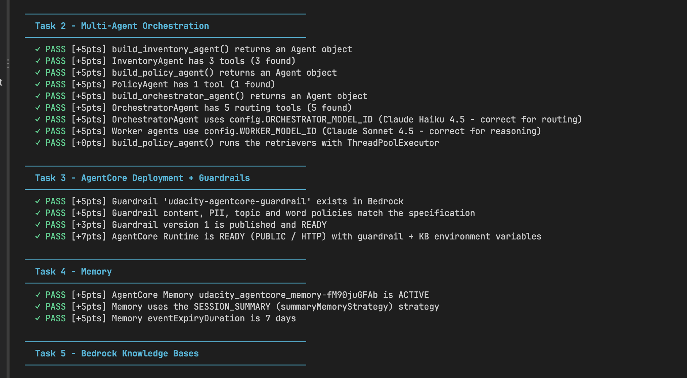
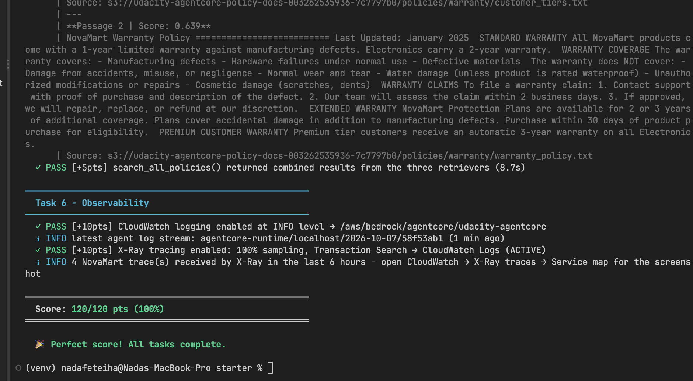
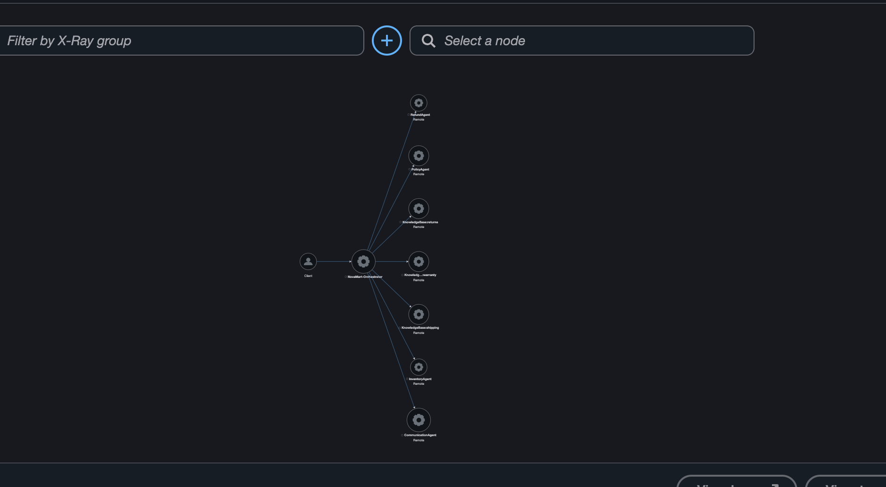

# NovaMart Multi-Agent Customer Support

This is my capstone project for the Udacity Agentic AI program (course 3.3, Enterprise Multi-Agent Architecture with Amazon Bedrock AgentCore).

NovaMart is a made-up online store. The goal was to build a customer support system where several AI agents work together to answer customers. One agent decides who should handle the request, other agents look up the data and make decisions, and a final agent writes the reply.

I built it with the [Strands Agents SDK](https://github.com/strands-agents/sdk-python) and deployed it to Amazon Bedrock AgentCore.


## How it works

There are five main agents:

- **OrchestratorAgent** (Claude Haiku 4.5): reads the request and calls the right agents in the right order. It never writes the answer itself.
- **InventoryAgent** (Claude Sonnet 4.5): looks up orders and customer info in DynamoDB. It only reports facts.
- **RefundAgent** (Claude Sonnet 4.5): decides if a return is allowed. Standard customers have 30 days and Premium customers have 60. If the order is eligible, it creates the return.
- **PolicyAgent** (Claude Sonnet 4.5): answers policy questions. It runs three smaller retriever agents at the same time (returns, shipping, warranty), each searching its own Bedrock Knowledge Base, and then combines what they found.
- **CommunicationAgent** (Claude Sonnet 4.5): writes the final message to the customer using everything the other agents found.

The agents share their results through one DynamoDB record per session, called `WorkflowState`. Each update checks a `version` number first (optimistic locking), so two agents can't overwrite each other.

The orchestrator follows these routing rules:

1. Always start with `initialize_session`.
2. Order status, return or refund: Inventory first, then Refund.
3. Policy question: Policy.
4. Account question like "am I premium?": Inventory, never Policy.
5. Math question: skip Inventory, Policy and Refund.
6. Always end with Communication.


### Other parts

- **Guardrail:** blocks harmful content, credit card numbers and SSNs, and hides emails and phone numbers. It also blocks three topics: competitors, price haggling, and legal threats. Normal price calculations are still allowed.
- **AgentCore Runtime:** the agents are deployed with the AgentCore CLI.
- **AgentCore Memory:** a session-summary memory that keeps events for 7 days.
- **Observability:** logs go to CloudWatch, and every request shows up as a trace in X-Ray.

## Results

All tests pass (120/120):




I ran the three required scenarios:

| Request | Agents called | Result |
|---|---|---|
| "I want to return my wireless headphones from order ORD-27176" (CUST-001, Premium) | Orchestrator → Inventory → Refund → Communication | Return approved, because it was within the 60-day window |
| "What is the return policy for premium customers?" | Orchestrator → Policy (3 retrievers in parallel) → Communication | Answer based on the policy documents |
| "How much would 5 items at $29.99 be with a 10% discount?" | Orchestrator → Communication | $134.96 |

I also tested the guardrail:

| Input | Result |
|---|---|
| The math question | Allowed |
| Asking for a lower price | Blocked |
| Asking about competitors | Blocked |
| A legal threat | Blocked |
| A credit card number | Blocked |
| Email or phone number in a reply | Masked |

The X-Ray service map shows the orchestrator calling the worker agents and the three Knowledge Bases:



## Challenges and what I learned

- **Outdated starter code.** My local copy of the starter code was an older version than the one in the project instructions. It was missing some helper files and had a different deploy method. I compared it with the course GitHub repo and switched to the newer version before writing any code.
- **Agents failing when running together.** When I first tested the orchestrator, the "am I premium?" question got a wrong answer. I found out that Strands runs the tool calls from one model turn at the same time by default. The orchestrator called `initialize_session` and `route_to_inventory_agent` together, both tried to create the same DynamoDB record, and the inventory call failed. Then the CommunicationAgent guessed the answer. I fixed it by:
  - making the orchestrator run its tools one at a time (`SequentialToolExecutor`)
  - handling the case where the record already exists
  - telling the CommunicationAgent never to guess when information is missing
- **Picking the right Knowledge Base type.** The AWS console kept sending me to "Managed Knowledge Base" first. The project needs the self-managed "Knowledge Base with vector store" option, so it can use the S3 Vectors bucket and indexes from the CloudFormation stack.
- **Lab account issues.** The Udacity AWS credentials expire every few hours, so I had to refresh them often, especially before the deploy, which takes several minutes.
- **Keeping test data clean.** Testing a return changes the order status in DynamoDB. I re-ran the seed script after testing so the required scenario would still work.

## Project structure

```
.
├── src/
│   ├── agent_orchestrator.py    # my main work: the 5 agents, guardrail, deploy, memory, observability
│   ├── agent_observability.py   # provided: X-Ray tracing and CloudWatch logging
│   ├── agentcore_cli.py         # provided: wrapper around the AgentCore CLI
│   ├── bedrock_kb_retrieval.py  # provided: Knowledge Base search helper
│   ├── agent_utils.py           # provided: terminal output for chat/demo
│   └── demo.py                  # provided: runs one example request
├── infrastructure/              # provided: CloudFormation stack, seed data, cleanup script
├── agentcore/                   # AgentCore CLI project files
├── tests/test_agent.py          # provided test suite
├── diagrams/                    # architecture diagrams
├── imgs/                        # my test and X-Ray screenshots
├── config.py                    # reads CloudFormation outputs and .env
└── .env                         # my resource IDs (no AWS keys)
```

## How to run it

**Requirements:**
- An AWS account in `us-east-1` with access to Claude Haiku 4.5, Claude Sonnet 4.5 and Titan Text Embeddings V2
- Python 3.12, Node.js 20+ and `uv`
- The AgentCore CLI: `npm install -g @aws/agentcore@0.30.0`

**1. Install the Python packages:**

```bash
python3.12 -m venv venv
source venv/bin/activate
pip install -r requirements.txt
```

**2. Deploy the base infrastructure and add the sample data:**

```bash
aws cloudformation deploy --template-file infrastructure/starter_stack.yaml \
  --stack-name udacity-agentcore --capabilities CAPABILITY_NAMED_IAM --region us-east-1
python infrastructure/seed_data.py
python config.py
```

**3. Create the Knowledge Bases.** In the Bedrock console, create three self-managed Knowledge Bases (returns, shipping, warranty):
- Use Titan Text Embeddings V2.
- Use the stack's S3 Vectors bucket, with the matching index for each one.
- Sync each one, then put the IDs in `.env`.

**4. Try it locally:**

```bash
python src/agent_orchestrator.py chat   # interactive chat
python src/agent_orchestrator.py test   # runs the 3 scenarios
```

**5. Deploy to AgentCore:**

```bash
python src/agent_orchestrator.py deploy
```

Then copy the printed runtime ARN and guardrail ID/version into `.env`.

**6. Run the tests:**

```bash
python tests/test_agent.py all
```

**7. Clean up when done:**

```bash
python infrastructure/cleanup.py --yes
```
